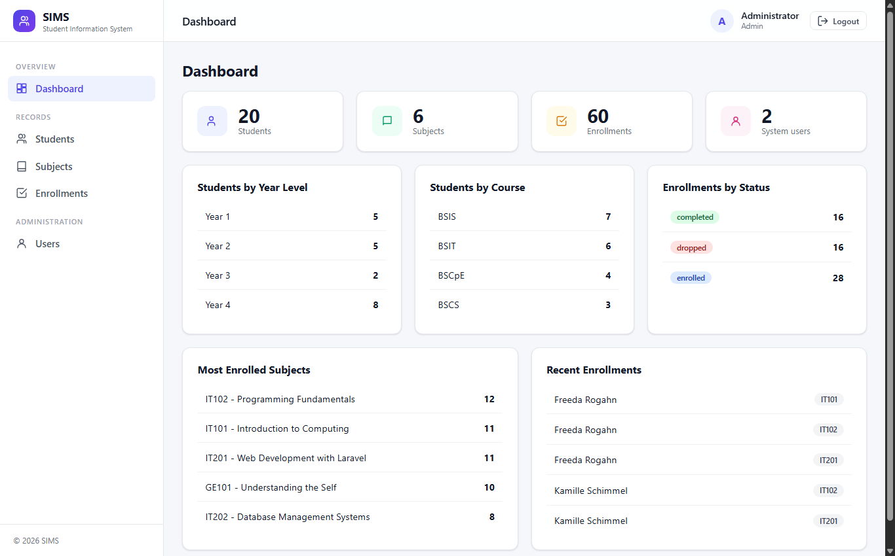
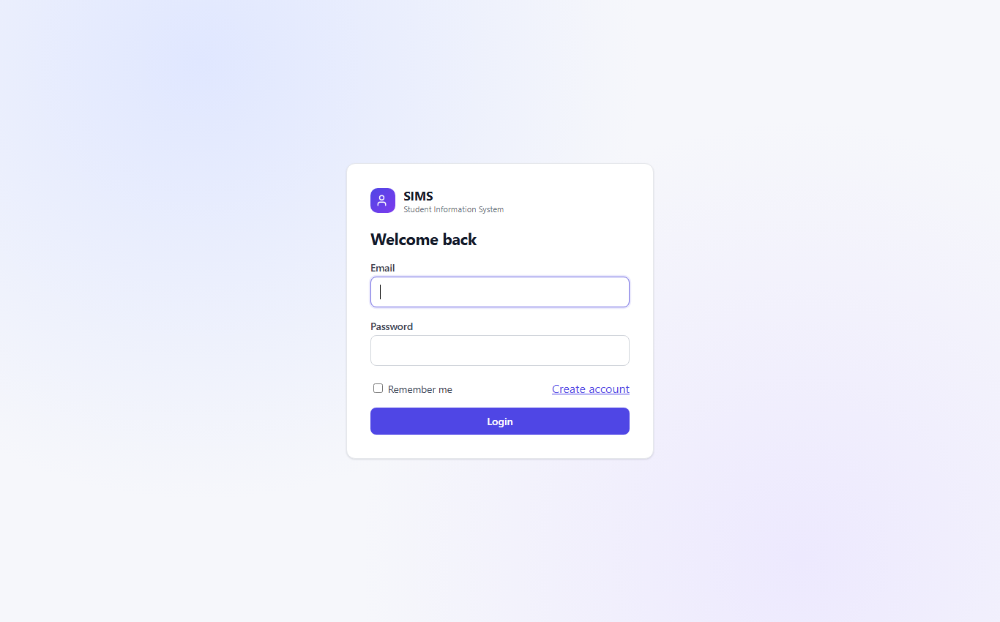
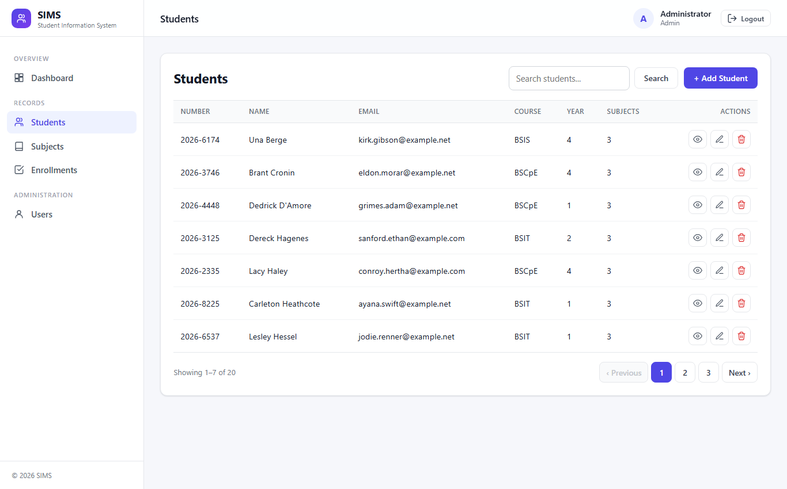
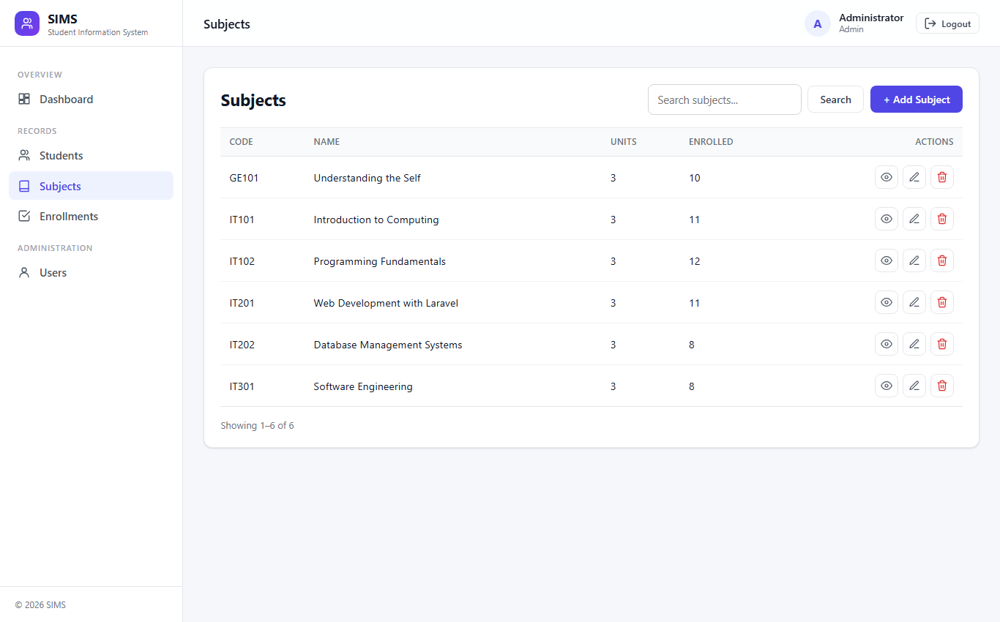
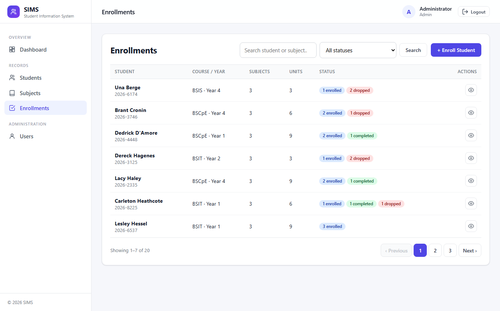
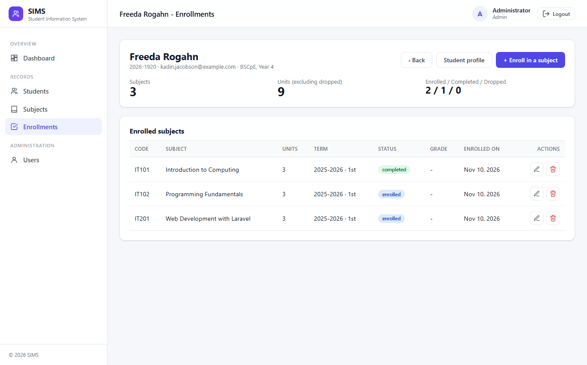
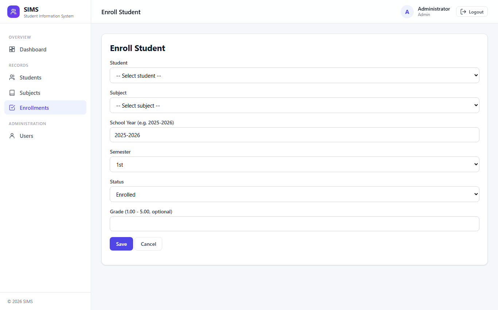
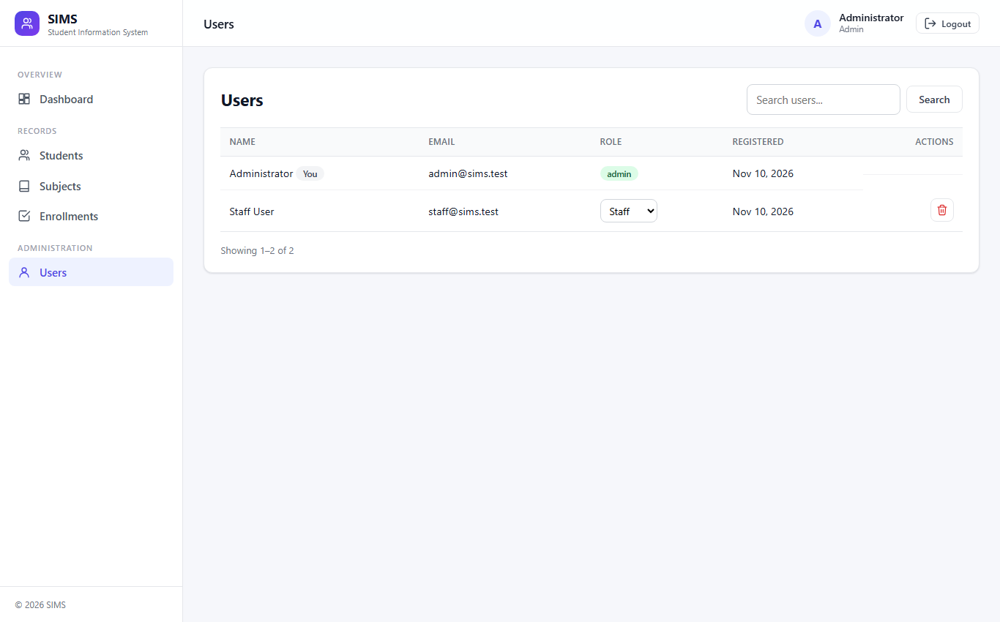

# Student Information Management System (SIMS)

Laravel 12 web application + REST API for managing students, subjects and enrollments.
Final project: AI-Assisted Laravel Development.



## Features

- **Authentication** – register, login, logout (session); bearer-token login for the API (Laravel Sanctum). Login/register are rate limited.
- **Authorization** – roles `admin` and `staff`.
  - `admin`: everything, including deleting records and the **Users** page (change roles, delete users).
  - `staff`: view, create, edit. Cannot delete, cannot open `/users` (403).
  - Self-registration always creates `staff`; `role` is not mass-assignable.
- **Students / Subjects / Enrollments** – full CRUD, search, 7 rows per page, server-side validation with error messages.
- **Enrollments** – the list shows **one row per student** (subject count, units, status summary); the view button opens that student's enrolled subjects with term, status, grade and per-subject edit/remove. Student ⇄ subject (many-to-many through `enrollments` with school year, semester, status, grade); the same subject can't be enrolled twice in a term.
- **Dashboard** – totals, students by year/course, enrollments by status, top subjects, recent enrollments.
- **UI** – responsive sidebar (drawer on mobile), sticky header with logout, unified data table component, icon buttons with tooltips, back-to-top button.
- **REST API** – `/api/students` CRUD with search and pagination, OpenAPI documentation.
- **Tests** – 32 tests (feature + unit).

## Setup

Requirements: PHP 8.2+, Composer. SQLite is the default database, so no database server is required.

```bash
composer install
cp .env.example .env
php artisan key:generate
php -r "touch('database/database.sqlite');"
php artisan migrate --seed
php artisan serve
```

Open http://127.0.0.1:8000. (No front-end build step is needed; styles are inline in the layout.)

### Database setup options

| Option | Steps |
|---|---|
| Migrations + seeder (recommended) | `php artisan migrate --seed` |
| Restore the included export | `sqlite3 database/database.sqlite < database/sims_export.sql` (schema + demo data) |
| MySQL | Set `DB_CONNECTION=mysql`, `DB_HOST`, `DB_PORT`, `DB_DATABASE`, `DB_USERNAME`, `DB_PASSWORD` in `.env`, then `php artisan migrate --seed` |

`database/sims_export.sql` was verified by restoring it into an empty database (2 users, 20 students, 6 subjects, 60 enrollments).

### Demo accounts (seeder)

| Role | Email | Password |
|---|---|---|
| Admin | admin@sims.test | password |
| Staff | staff@sims.test | password |

Change these before any real deployment.

## Database design

```
users(id, name, email*, password, role)
students(id, student_number*, first_name, last_name, email*, course, year_level)
subjects(id, code*, name, units)
enrollments(id, student_id → students, subject_id → subjects, school_year, semester, status, grade)
    unique(student_id, subject_id, school_year, semester)          * = unique
```
Foreign keys cascade on delete. Eloquent: `Student hasMany Enrollment`, `Student belongsToMany Subject` (and the inverse).

## Architecture (MVC)

| Layer | Location |
|---|---|
| Routes | `routes/web.php`, `routes/api.php` |
| Controllers (thin) | `app/Http/Controllers` (+ `Api/`, `Auth/`, `Admin/`) |
| Validation | Form Requests in `app/Http/Requests` |
| API formatting | `app/Http/Resources/StudentResource.php` |
| Authorization | `EnsureUserIsAdmin` middleware, alias `admin` |
| Views | Blade in `resources/views`; reusable components `x-data-table`, `x-action-button` |

## REST API

Interactive documentation (Swagger UI): http://127.0.0.1:8000/api-docs.html — the spec is `public/openapi.yaml` (importable into Postman).

All endpoints except `/api/login` need `Authorization: Bearer <token>` and `Accept: application/json`.

| Method | URL | Description | Role |
|---|---|---|---|
| POST | `/api/login` | Get a token `{email, password}` | public |
| POST | `/api/logout` | Revoke current token | any |
| GET | `/api/students` | List (`?q=`, `?course=`, `?per_page=`, `?page=`) | any |
| GET | `/api/students/{id}` | Show with enrollments | any |
| POST | `/api/students` | Create → 201 | any |
| PUT/PATCH | `/api/students/{id}` | Update | any |
| DELETE | `/api/students/{id}` | Delete → 204 | admin |

Errors: `401` unauthenticated, `403` forbidden, `404 {"message":"Resource not found."}`, `422` validation errors.

```bash
curl -X POST http://127.0.0.1:8000/api/login -H "Accept: application/json" \
  -d email=admin@sims.test -d password=password
# → {"token":"1|...","token_type":"Bearer","role":"admin"}

curl -H "Accept: application/json" -H "Authorization: Bearer <token>" http://127.0.0.1:8000/api/students
curl -X POST -H "Accept: application/json" -H "Authorization: Bearer <token>" http://127.0.0.1:8000/api/students \
  -d student_number=2026-9999 -d first_name=Ana -d last_name=Cruz -d email=ana@example.com -d course=BSIT -d year_level=1
```

## Testing

```bash
php artisan test      # 32 tests: auth, CRUD, validation, authorization, API, user admin, rate limiting
```

## Screenshots

| | |
|---|---|
|  |  |
|  |  |
|  |  |
|  | |

## Project documents (`docs/`)

- `ai-portfolio.pdf` – AI tools, prompt history, iterations, screenshots
- `agent-design.pdf` – agent roles, context and token management
- `reflection.pdf` – what worked/failed, AI mistakes, corrections, lessons

The sources are the `.md` files next to them. Replace the `[Student name]` and `[Add ...]` placeholders with your own details
(the handbook requires you to be able to defend every part of the project).
The handbook names the files `AI_PORTFOLIO.pdf` / `AGENT_DESIGN.pdf` / `REFLECTION.pdf` while the rubric uses lowercase-hyphen names; rename if your instructor prefers.

## Git (for the project owner)

This folder is initialised as a git repository **with no commits**, so the history will be yours. Suggested flow, committing
as you review and understand each part (the bonus rewards a real, incremental history, not a single upload):

```bash
git config user.name  "Your Name"
git config user.email "you@example.com"
git add composer.json composer.lock app/Models database && git commit -m "Add schema, models and seeders"
# …continue per feature: auth, students, subjects, enrollments, API, UI, tests, docs
```
`.env`, `vendor/`, `node_modules/` and `database/*.sqlite` are already git-ignored.

## Not done (optional bonus items)

Deployment (Railway/Render/etc.), the multi-tool AI comparison study (GPT/Gemini/Copilot), and a real commit history —
these depend on your own accounts and work, so they were intentionally left out rather than faked.
