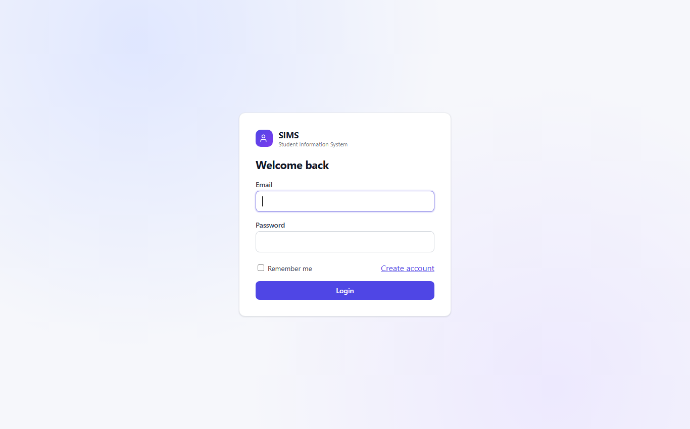
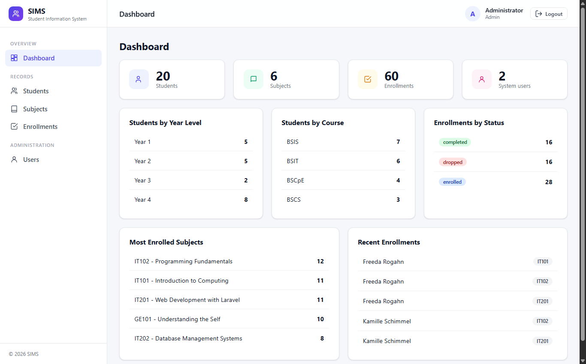
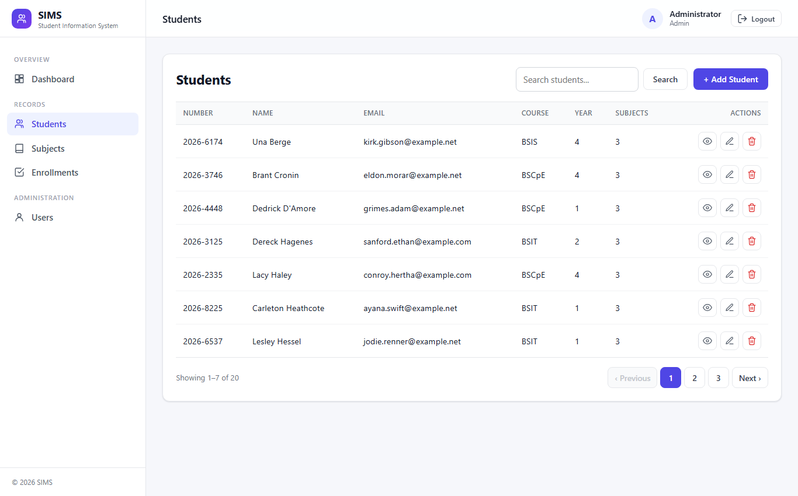
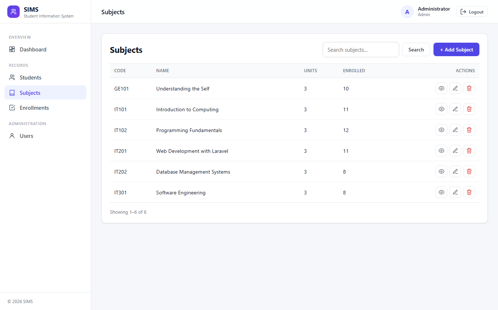
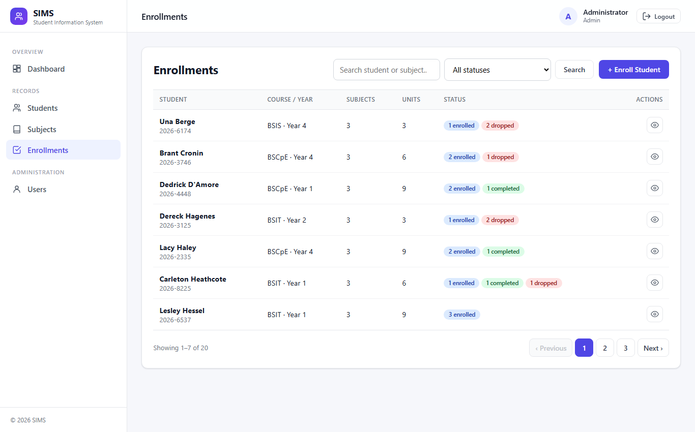
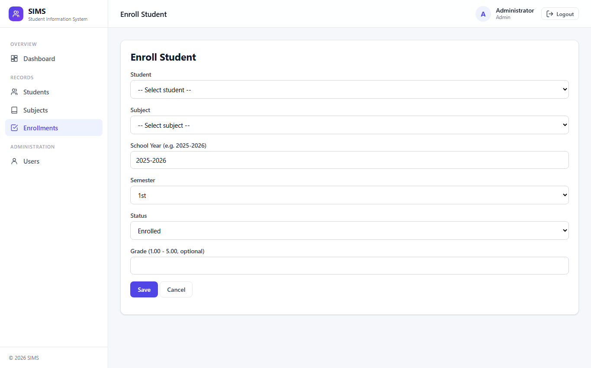
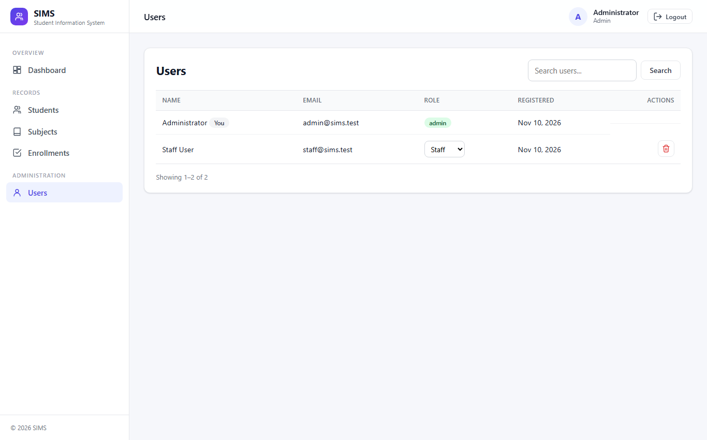

# AI Engineering Portfolio

**Project:** Student Information Management System (SIMS) – Laravel 12, Web + REST API
**Student:** [Student name]  **Course:** Laravel Web Development

> Honesty note: everything below documents the AI-assisted process that was actually used to build this
> repository. If you used additional tools (ChatGPT, Copilot, Gemini, ...) add them in section 1; this
> document does not claim any tool that was not used.

## 1. AI platforms used

| Platform | Model | Purpose | Strengths observed | Why selected |
|---|---|---|---|---|
| Claude Code (CLI agent) | Claude Sonnet 5.5 (`claude-sonnet-5-5`) | Planning, scaffolding, writing code, tests, docs; running Composer/Artisan/PHPUnit in the project folder | Reads the whole project, runs commands and tests itself, edits many files consistently | An agentic tool can read the handbook PDFs, build, run and verify in one loop |
| Headless Chrome (tool, not an AI) | n/a | Rendering pages to PNG screenshots for the README and this portfolio | Reproducible screenshots without manual steps | Needed for documentation evidence |

No AI comparison study was performed (GPT / Gemini / Copilot were not used), so that bonus is not claimed.

## 2. Prompt history (real prompts, in order)

| # | Type | Prompt (verbatim) | Result |
|---|---|---|---|
| 1 | **Initial** | "read everything on this directory, and build the application base on the instruction" | Read handbook, rubric, bonus file; scaffolded Laravel 12 with auth, roles, CRUD, API, tests, README |
| 2 | Follow-up | "give me example credentials" | Listed seeded demo accounts and API token request |
| 3 | Question | "is there any instruction saying sims must be the name of the folder" | Checked handbook: no such rule; offered rename |
| 4 | Refinement | "rename it to student-information-system" | First attempt failed (folder locked by a running `php artisan serve`); asked before killing processes, renamed after the user stopped them |
| 5 | **Refined (UI)** | "fix the ui, instead of header navbar, make it sidebar" | Sidebar layout |
| 6 | **Refined (UI)** | "add a header, for logout, then make the ui more modern" | Top bar with user + logout, new design system, icons |
| 7 | Refined | "make the datatable unified. pagination must be 7 then fix the pagination design" | `x-data-table` Blade component, 7 rows/page, custom pagination view |
| 8 | **Debug/Refine** | "the previous and next button on pagination, must have a max of 5 numbers" | Windowed pager (max 5 numbers) |
| 9 | Refinement | "on datatable, i think it's better if the button is icon only, then put a title on element" | `x-action-button` component, icon-only with tooltip + aria-label |
| 10 | Refinement | "on mobile, make it closable sidebar ... also add a to top button" | Off-canvas drawer, hamburger, sticky header, back-to-top |
| 11 | Refinement | "datatable must have no border radius, and must not have no borders on x, only y" | Ambiguous wording; interpreted as no left/right borders, horizontal lines only; interpretation stated back to the user |
| 12 | **Validation prompt** | "can you audit the site if it's still in the instruction?" | Compared routes/features/tests with the handbook & rubric; produced a gap list |
| 13 | Refinement | "forget about the 80rem max-width rule on main content make it 100%" | Removed the width cap (it was 1100px, not 80rem; reported) |
| 14 | **Completion prompt** | "audit the site, then complete everything, (context: this is for someone else so i think we might need a little tweak on git)" | Closed the gaps (below); asked which git approach before touching git |
| 15 | Refinement | (pasted three rows for one student) "on enrollment, i saw these ... can you make it only one, then when view, you can see their enrolled subjects, and details" | Enrollment list grouped to one row per student; new detail page per student |

## 3. Prompt iterations (how prompts evolved)

1. **Broad -> constrained.** Prompt 1 was a single broad instruction. The agent turned it into a checklist from the
   handbook (features, suggested fields, API list, rubric weights) before writing code.
2. **UI by small, single-purpose prompts (5 -> 10).** Each prompt changed one thing (sidebar, then header,
   then datatable, then pagination, then icons, then mobile). Small prompts kept the context small, made each
   change easy to review and to roll back.
3. **Constraint tightening (7 -> 8).** "pagination must be 7" produced a working pager, but the user then added
   a precise constraint ("max of 5 numbers"). The agent replaced Laravel's default window logic with its own and
   verified the output for pages 1, 2, 3, 5, 8, 9 of a 10-page set.
4. **Ambiguity handling (11).** The agent did not guess silently: it stated its reading ("left/right borders removed,
   horizontal lines kept") and offered to flip it.
5. **Validate then fix (12 -> 14).** The audit prompt produced evidence (route list, test results, file checks);
   the next prompt consumed that gap list.

## 4. Screenshots

| | |
|---|---|
|  **Login** |  **Dashboard** |
|  **Students (unified data table, pagination)** |  **Subjects** |
|  **Enrollments** |  **Enroll form** |
|  **Enroll form** |  **Admin-only user management** |

Screenshots were produced from the real application views with the seeded data (20 students, 6 subjects, 60 enrollments).
